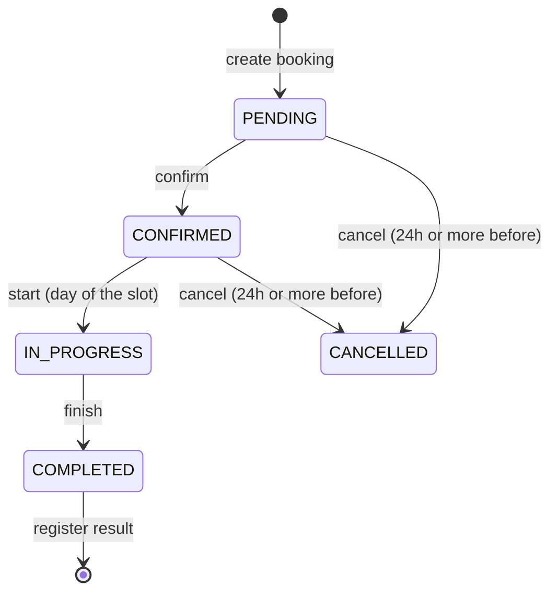
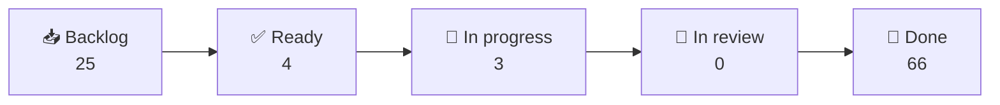

<div align="center">

# 🔐 Escape Room Management

**A web platform to browse escape rooms in an immersive 3D corridor, book a time slot, and run the games on the day.**


[📖 Overview](#-overview) • [🚀 Getting started](#-getting-started) • [🧪 Tests](#-running-the-tests) • [🔌 API](#-api) • [🧱 Architecture](#-architecture) • [🎨 Colors](#-project-colors) • [📋 Kanban](#-kanban) • [📚 Docs](#-documentation)

</div>

## 📖 Overview

At the **Factoría F5 bootcamp (IA P1, Barcelona)** our team of four built an app for an **escape room business**: a REST API (FastAPI) and a React client to browse the rooms, book a time slot and run the games on the day.

**🧩 The problem it solves**

Escape room owners often manage bookings with phone calls, messages and spreadsheets. That leads to double bookings, last-minute cancellations nobody can track, and staff who do not know who is arriving or which room is free.

This app puts everything in one place: customers book online and the system makes double booking impossible; staff see exactly who plays today; owners manage rooms and schedules without touching the database.

**👥 Who is it for?**

- 🧑‍🤝‍🧑 **Clients** browse the rooms, book, modify or cancel (24h rule) and see their game history and results.
- 🧑‍✈️ **Staff** see today's bookings, start and finish games and register results.
- 🛠️ **Admins** manage rooms, time slots, users and roles.

**✨ Features**

- 🚪 Immersive 3D corridor (Three.js) with an accessible poster-grid fallback
- 📅 Slot grid with live states: free, taken, blocked, past
- 🔒 Google login via Supabase and role-based access (client / staff / admin)
- 🎮 Game flow: `PENDING → CONFIRMED → IN_PROGRESS → COMPLETED`
- 🚫 Double booking impossible (enforced by the database)
- 📘 Interactive API docs (Swagger UI), generated automatically

## 🚀 Getting started

**Prerequisites:** Git, Docker Desktop (with Docker Compose).

```bash
git clone https://github.com/IA-P1-BCN/g5-python-crud-api.git
cd g5-python-crud-api
cp .env.example .env          # review the values, never commit .env
docker compose up -d --build
docker compose exec api alembic upgrade head
```

| URL                           | What                          |
| ----------------------------- | ----------------------------- |
| http://localhost:3000         | Web client (Vite, hot reload) |
| http://localhost:8000/docs    | Swagger UI                    |
| http://localhost:8000/redoc   | ReDoc                         |

> 💡 **Tip:** The front proxies `/api` to the API container, so the browser talks to one origin and no CORS setup is needed.

> 📝 **Note:** **Shared team database (optional):** set `SHARED_DATABASE_URL` in your `.env` to use the common Supabase PostgreSQL instead of the local container. Migrations on it affect the whole team: coordinate first. Optionally `ALEMBIC_DATABASE_URL` picks a specific migration target.

> ⚠️ **Warning:** Never run `docker compose down -v`: it deletes the local database volume. Never commit real connection strings.

**Initial admin:** set `ADMIN_EMAILS` (comma-separated) in `.env`. Those emails get the `admin` role on their **first login only**; everyone else is a `client`.

## 🧪 Running the tests

```bash
# Backend: pytest + httpx, SQLite in-memory
docker compose exec api pytest
docker compose exec api ruff check .

# Frontend: prettier + eslint + vitest (run before each PR)
docker compose run --rm front-tools
```

> 📝 **Note:** `front-tools` runs `prettier --write` on the whole `front/`. After it, `git status` and restore the files that are not yours.

### Test coverage

```bash
# Backend (rebuild once so pytest-cov is installed: docker compose up -d --build)
docker compose exec api pytest --cov --cov-report=term
open back/htmlcov/index.html

# Frontend (after pulling: docker compose restart front, or npm install in front/)
docker compose exec front npm run coverage
open front/coverage/index.html
```

The terminal prints the total. The HTML page lists every folder and file with its percentage, and clicking a file shows the covered and uncovered lines. Reports are generated files: `back/htmlcov/` and `front/coverage/` are in `.gitignore`, never commit them.

**Migrations:** `alembic current` · new one: `alembic revision --autogenerate -m "describe the change"` (review it before applying).

## ⏱️ How a booking works



`total_price = room.base_price × players`. Double booking is impossible: a partial unique index on `bookings(time_slot_id)` guards active bookings.

## 🔌 API

Base path `/api/v1`. Errors always look like `{ "detail": "...", "code": "SLOT_TAKEN" }`. Lists are paginated (`?page=1&size=20`). Full contract: [API_CONTRACT.md](docs/API_CONTRACT.md).

| Resource   | Main endpoints                                                                                   |
| ---------- | ------------------------------------------------------------------------------------------------ |
| 👤 Users   | `POST/GET /users` · `GET /users/me/history` · `PUT /users/{id}/role` (admin)                     |
| 🚪 Rooms   | `POST/GET /rooms` · `GET /rooms/{id or slug}` · `PUT /rooms/{id}` · `activate` / `deactivate`   |
| 🕒 Slots   | `POST/GET /time-slots` · `POST /rooms/{id}/time-slots/generate` (admin)                          |
| 📅 Bookings| `POST/GET /bookings` · `PUT …/confirm` · `cancel` · `start` · `finish` · `POST …/result`        |
| 📊 Reports | `GET /bookings/today` (staff) · `GET /users/me/history` |
| ❤️ Health  | `GET /health`                                                                                    |

## 🧱 Architecture

MVC on the back, feature folders on the front. Routes hold HTTP only, controllers hold the business rules and never import FastAPI.

```
g5-python-crud-api/
│
├── back/app/                  # FastAPI API
│   ├── models/                  → SQLAlchemy tables
│   ├── schemas/                 → Pydantic request / response
│   ├── controllers/             → Business rules (BR-*)
│   ├── routes/                  → HTTP only
│   ├── dependencies/            → get_current_user, require_role(...)
│   └── core/                    → errors, security (JWT), pagination
│
├── front/src/                 # React + Vite client
│   ├── app/                     → providers, routes, layout
│   ├── features/                → rooms, corridor, booking, my-bookings, auth,
│   │                              profile, staff, admin-rooms, admin-users
│   ├── shared/                  → Axios client, hooks, UI components
│   └── i18n/es/                 → All user-facing texts (Spanish)
│
├── alembic/                   # Migrations
├── docs/                      # PRD, STACK, ARCHI, API contract, rules, design
├── docker-compose.yml         # api + db + front (+ front-tools on demand)
└── pyproject.toml             # Dependencies, ruff and pytest config
```

On the front, the dependency flow is `app → features → shared`, enforced by ESLint. Data flows `Page → hook (TanStack Query) → api function → Axios → FastAPI`.

## 🧭 Key decisions

| Decision                                  | Why                                                                      |
| ----------------------------------------- | ------------------------------------------------------------------------ |
| One resource per person, same files       | Four people in parallel with few merge conflicts                         |
| Supabase used only for authentication     | Data stays in our PostgreSQL; role lives in our `users` table            |
| Nginx / Vite proxy instead of CORS        | The browser sees one origin                                              |
| JavaScript + Zod instead of TypeScript    | The team's language; data validated where it enters the app              |
| Tailwind with design tokens, no MUI       | One look from the mockup; the default Tailwind palette is forbidden      |
| Three.js corridor with a fallback         | Immersive on capable devices, always usable without WebGL                |

## 🎨 Project colors

Always dark. Use the tokens (`bg-surface`, `text-muted`, `border-line`…), never the default Tailwind palette: a test fails otherwise. Source: `front/src/index.css`, details in [DESIGN.md](docs/DESIGN.md).

**Base and action**

| Swatch | Token | Hex |
| :----: | ----- | --- |
|  | `bg` | `#0A0B0D` |
|  | `surface` | `#121418` |
|  | `surface-2` | `#1A1D23` |
|  | `text` | `#ECEAE4` |
|  | `muted` | `#A4A39B` |
|  | `exit` (primary action) | `#3DFF8F` |
|  | `error` | `#FF5A6E` |

**Booking states**

| Swatch | State | Hex |
| :----: | ----- | --- |
|  | `pending` | `#FFD166` |
|  | `confirmed` | `#3DFF8F` |
|  | `in-progress` | `#7CC4FF` |
|  | `done` | `#C4A6FF` |
|  | `cancelled` | `#FF8A98` |

**Room themes** (accent / dark background, switched with `data-room`)

| Swatch | Room | Accent | Dark |
| :----: | ---- | ------ | ---- |
|  | 🕰️ El Relojero | `#E0A243` | `#2A1B0D` |
|  | 📚 La Biblioteca Prohibida | `#4FC48F` | `#0C2A20` |
|  | 🌊 Faro 1923 | `#5CC3E6` | `#0A2734` |
|  | 💎 El Gran Atraco | `#FF4560` | `#1D0B10` |
|  | 🧪 Laboratorio Zero (default theme) | `#9AA0A6` | `#1B1D20` |

**Fonts:** Big Shoulders Display (titles) · Hanken Grotesk (body) · Share Tech Mono (codes, labels).

## 📋 Kanban

Work is tracked on the GitHub board **[escape_room_project](https://github.com/orgs/IA-P1-BCN/projects/29)**. Each ticket has an issue and a PR that closes it (`Closes #n`).



| Column         | Meaning                                  | Tickets |
| -------------- | ---------------------------------------- | :-----: |
| 📥 Backlog     | Identified, not ready to start           | 25      |
| ✅ Ready       | Clear acceptance criteria, can be taken  | 4       |
| 🚧 In progress | Someone is working on it                 | 3       |
| 👀 In review   | PR open, waiting for review              | 0       |
| 🎉 Done        | Merged into `develop`                    | 66      |

_Snapshot of 2026-10-19 (98 items); the board is the live source._

**Git flow:** branch from `develop` as `<type>/<ticket>-<desc>`, Conventional Commits, PR always to `develop`. Details in [CONTRIBUTING.md](docs/CONTRIBUTING.md).

## 📚 Documentation

| Doc                                      | Content                                  |
| ---------------------------------------- | ---------------------------------------- |
| [PRD](docs/PRD.md)                       | Context, scope per sprint                |
| [Stack](docs/STACK.md)                   | Technology choices                       |
| [Architecture](docs/ARCHI.md)            | Structure, layers, tests                 |
| [Business rules](docs/BUSINESS_RULES.md) | Rules of both sprints, permissions       |
| [User stories](docs/STORIES.md)          | Stories and acceptance criteria          |
| [Tickets](docs/TICKETS.md)               | Tickets and timeline                     |
| [Work split](docs/WORK_SPLIT.md)         | Who owns what                            |
| [API contract](docs/API_CONTRACT.md)     | Endpoints and error format               |
| [Design](docs/DESIGN.md)                 | Tokens and shared components             |
| [Rooms](docs/ROOMS.md)                   | Initial room catalogue                   |
| [Diagrams](docs/DIAGRAMS.md)             | ER, flows, state machine (Mermaid)       |
| [Contributing](docs/CONTRIBUTING.md)     | Git flow, PR rules                       |

## 🧰 Tech stack

|          |                                                                       |
| -------- | --------------------------------------------------------------------- |
| Backend  | Python 3.12, FastAPI, Pydantic v2, SQLAlchemy 2, Alembic, PostgreSQL 16 |
| Frontend | React 19, Vite, Tailwind 4, TanStack Query, Zustand, React Hook Form + Zod, Axios, Three.js |
| Auth     | Supabase Auth (Google), JWT validated by the API                      |
| Tests    | pytest + httpx, Vitest + Testing Library + MSW                        |
| Tooling  | Docker Compose, ruff, ESLint, Prettier                                |

> 📝 **Note:** The customers are Spanish-speaking, so the interface copy is in Spanish. Code, comments and commits are in English.

## 🔭 Next improvements

Planned but **not built yet**:

- 📊 Business statistics (bookings per room, occupancy, revenue) and the admin dashboard (tickets 046, 084)
- 📤 CSV export of bookings (tickets 047, 085)
- 📄 Pagination controls in the front lists (the API already paginates)
- 💳 Payments, discounts and loyalty points
- 👥 Names of the players in each booking (today only the number of players is stored)
- ⏳ Expiry of pending bookings
- 🔔 Real-time updates (websockets)
- ☁️ Cloud deployment

## 👩‍💻 Team

Built by the **G5** team at the Factoría F5 P1 IA School training, Barcelona.

| | Name | Role | GitHub |
| :-: | ---- | ---- | ------ |
| 🧑‍💼 | Leandro | Product Owner | [@Leandroletoile](https://github.com/Leandroletoile) |
| 🧑‍🏫 | Marie-Charlotte Doulcet | Scrum Master | [@Charlottedoulcet](https://github.com/Charlottedoulcet) |
| 👩‍💻 | Isbelita | Developer | [@Isbelita-dot](https://github.com/Isbelita-dot) |
| 👩‍💻 | Carolay Vasquez | Developer | [@carovasq](https://github.com/carovasq) |
