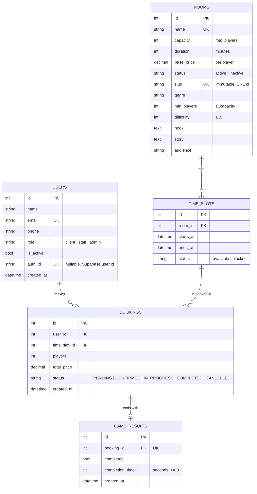
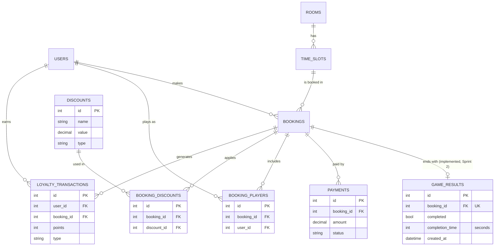
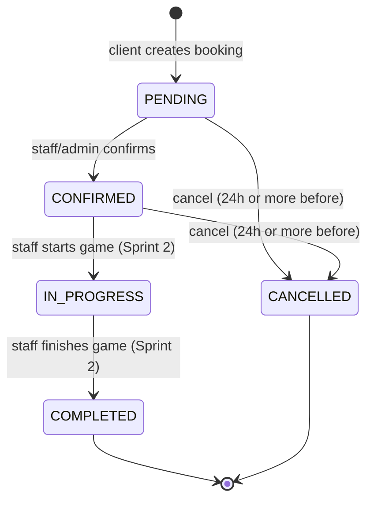
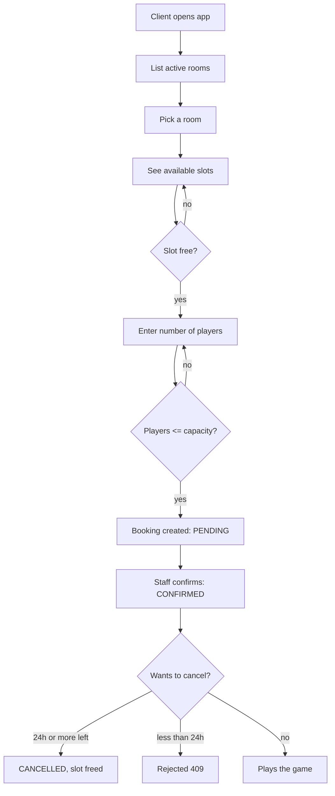
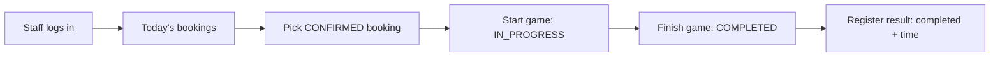
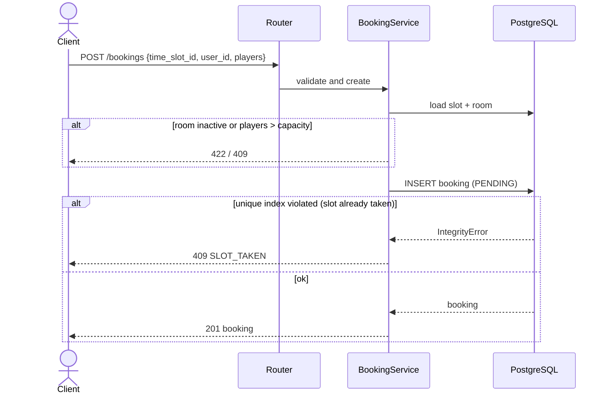
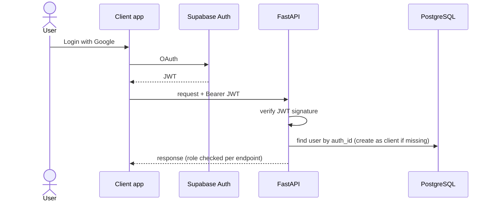

# DIAGRAMS

All diagrams are Mermaid: GitHub renders them directly.

## 1. ER diagram - MVP (Sprint 1)

Matches the models and Alembic migrations on `develop`. Changes vs the team's full ER: `users` gets `role` + `is_active` + `auth_id` (Supabase id, nullable until first login); `rooms` gets the catalog fields (`slug`, `genre`, `min_players`, `difficulty`, `hook`, `story`, `audience`, ticket 056); `time_slots.status` is only `available`/`blocked` (booked is computed, see BR-S5). Sprint 2 adds the `game_results` table and the booking statuses `IN_PROGRESS` / `COMPLETED`.

Constraints and indexes the diagram cannot show:
- `bookings`: partial unique index on `time_slot_id` where status is `PENDING`, `CONFIRMED` or `IN_PROGRESS` (BR-B8); indexes on `user_id` and `time_slot_id`; `players >= 1`.
- `time_slots`: PostgreSQL exclusion constraint `ex_time_slots_no_overlap` (same room, overlapping time range, BR-S3); `ends_at > starts_at`; index on (`room_id`, `starts_at`).
- `rooms`: checks `capacity >= 1`, `duration > 0`, `base_price >= 0`, `min_players` between 1 and `capacity`, `difficulty` between 1 and 5.
- `users`: check `role IN ('client', 'staff', 'admin')`.

## 2. ER diagram - full vision (Phase 2/3)

The team's complete model. Tables with a Sprint tag are in scope, the rest are not committed.

## 3. Booking state machine

## 4. User flow - client booking

## 5. User flow - staff on game day (Sprint 2)

## 6. Booking creation sequence

## 7. Auth flow (Sprint 2)

