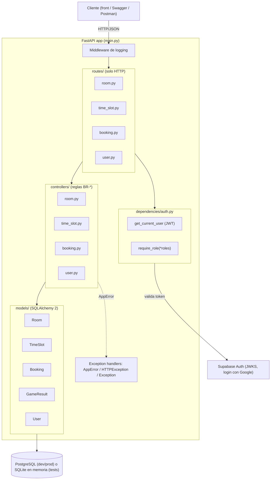
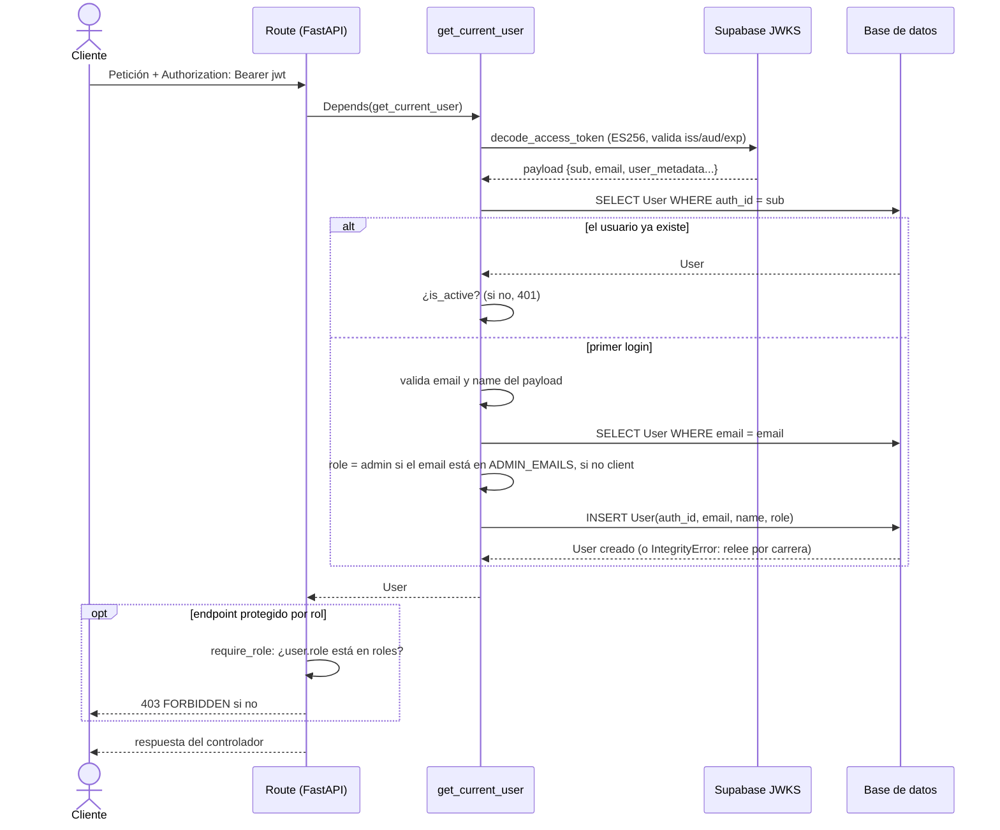
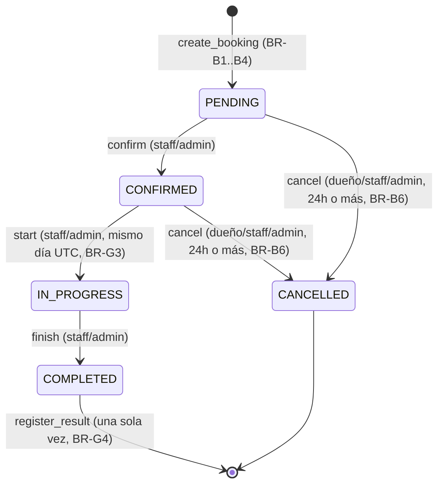
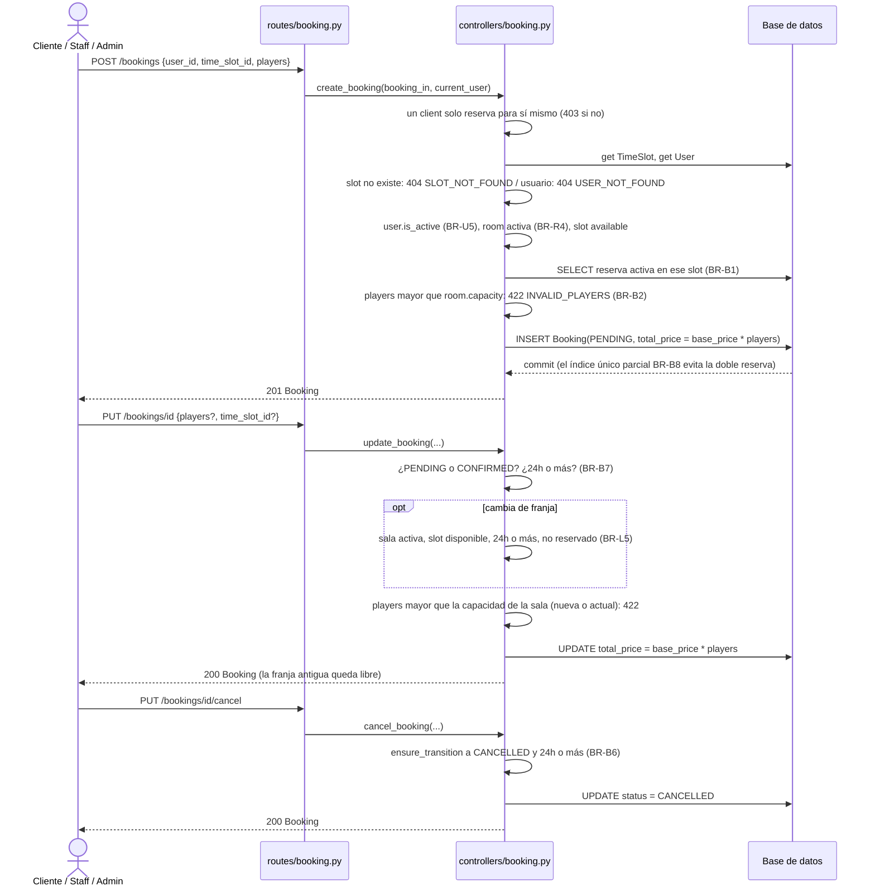

# Flujos y funcionalidades del back

Documento generado leyendo el código real de `back/app/` (rama `develop`), no solo los `docs/*.md`. Se compara con `API_CONTRACT.md` y `BUSINESS_RULES.md`; las diferencias se marcan con **⚠️**.

## 1. Visión general y arquitectura en capas

El back sigue MVC como describe `ARCHI.md`, y el código lo respeta:

- **Rutas** (`back/app/routes/*.py`): solo HTTP. Parsean la petición, llaman al controlador y devuelven el resultado.
- **Controladores** (`back/app/controllers/*.py`): toda la lógica de negocio (BR-*). Usan SQLAlchemy y lanzan `AppError`.
- **Modelos** (`back/app/models/*.py`): tablas SQLAlchemy 2 y propiedades calculadas (`Room.has_upcoming_slots`, `TimeSlot.state`, `Booking.TRANSITIONS`).
- **Schemas** (`back/app/schemas/*.py`): Pydantic v2, lo que ve el cliente.
- **Transversal:** `dependencies/auth.py` (JWT y roles), `core/errors.py` (`AppError`), `core/pagination.py`, `core/datetimes.py`.

Punto de entrada: `back/app/main.py` crea la app FastAPI, registra el middleware de logging y 3 manejadores de excepciones, y monta los 4 routers bajo `/api/v1`.

## 2. Autenticación y roles

### 2.1 Validación del JWT

`back/app/core/security.py`: el token de Supabase **no** se valida con un secreto compartido sino contra el **JWKS** público de Supabase (`PyJWKClient`, algoritmo `ES256`), construido desde `SUPABASE_URL`. Se exige `aud="authenticated"`, `iss` y los claims `exp`, `sub`, `aud`, `iss`.

> ⚠️ `docs/STACK.md:77` documenta `SUPABASE_JWT_SECRET`, pero `back/app/config/settings.py` ni la declara ni la lee. Si está en `.env` se ignora. La seguridad real depende solo de `SUPABASE_URL` + JWKS.

### 2.2 Primer login y creación del usuario (BR-A2)

`back/app/dependencies/auth.py` (`get_current_user`):

1. Sin credenciales: 401 `UNAUTHORIZED`.
2. Decodifica el token; si falla: 401.
3. Busca un `User` por `auth_id == sub`. Si existe, comprueba `is_active` (si no, 401) y lo devuelve.
4. Si no existe (primer login): toma `email` del claim (validado y en minúsculas) y `name` (de `user_metadata.full_name`, `user_metadata.name` o `name`). Si falta algo válido: 401.
5. Si ya existe un `User` con ese email pero otro `auth_id`: 409 `DUPLICATE`. Nunca asocia una cuenta existente a otra identidad.
6. **Bootstrap del primer admin (ticket 053):** si el email está en `ADMIN_EMAILS` (CSV, `settings.py`), `role="admin"`; si no, `role="client"`.
7. Inserta el `User`. Si hay `IntegrityError` (carrera entre dos peticiones), hace `rollback()` y relee el usuario creado por la otra, o lanza `DUPLICATE` si colisionó el email.

### 2.3 `require_role`

Fábrica de dependencia que envuelve `get_current_user` y lanza `AppError("FORBIDDEN", 403)` si `user.role not in roles`. Se usa como `dependencies=[Depends(require_role("staff", "admin"))]` en las rutas.

## 3. Ciclo de vida de una reserva (`Booking`)

Las transiciones válidas están centralizadas en `back/app/models/booking.py` (`ACTIVE_STATUSES`, `TRANSITIONS`, `ensure_transition`), así la regla BR-G2 no se duplica.

Reglas añadidas en `back/app/controllers/booking.py`:

- **Modificar** (`update_booking`): solo en `PENDING`/`CONFIRMED` y con **24 h o más** hasta `time_slot.starts_at` (BR-B7). Si cambia de franja, la nueva debe ser reservable y estar también a 24 h o más (BR-L5).
- **Cancelar** (`cancel_booking`): usa `ensure_transition` (solo `PENDING`/`CONFIRMED` a `CANCELLED`) **y además** exige 24 h o más (BR-B6). `ensure_transition` por sí solo no impone el plazo.
- **Confirmar** (`confirm_booking`): solo la transición `PENDING` a `CONFIRMED`, sin regla de 24 h. Solo `staff`/`admin`.
- **Start** (`start_booking`): `CONFIRMED` a `IN_PROGRESS` y la fecha de la franja debe ser hoy en UTC (BR-G3). `staff`/`admin`.
- **Finish** (`finish_booking`): `IN_PROGRESS` a `COMPLETED`, sin más condición. `staff`/`admin`.
- **La franja se libera sola al cancelar:** `TimeSlot.is_taken` se calcula mirando si hay una reserva en `ACTIVE_STATUSES`; al pasar a `CANCELLED` deja de contar.

Modificar (jugadores y/o franja) solo es posible en `PENDING` o `CONFIRMED`, con 24 h o más de margen (BR-B7, BR-L5).

## 4. Crear, modificar, cambiar de sala y cancelar: flujo y precio

`total_price = room.base_price * players` se recalcula al **crear** y al **modificar**. Si la reserva se mueve a una franja de otra sala, se usa el `base_price` de la sala nueva (BR-L5).

`_ensure_can_access` se aplica en get, update y cancel: un `client` solo toca sus reservas; `staff`/`admin` cualquiera.

## 5. Salas y franjas horarias

### 5.1 Estado de la franja (`TimeSlot.state`)

Propiedad calculada (no guardada), con precedencia **`past` > `blocked` > `taken` > `free`**:

- `past`: `ends_at <= now`.
- `blocked`: `status == "blocked"` (lo gestiona el admin, BR-S4).
- `taken`: existe una reserva en `ACTIVE_STATUSES` (`PENDING`/`CONFIRMED`/`IN_PROGRESS`).
- `free`: ninguna de las anteriores.

`is_bookable` (BR-S5) es `status == "available"` y no `is_taken`, igual que el contrato.

### 5.2 Creación y edición individual (`controllers/time_slot.py`)

- `create_time_slot_controller`: la sala debe existir y estar activa (`ROOM_INACTIVE`), `starts_at` no puede estar en el pasado (BR-S2), `ends_at > starts_at` (BR-S1) y sin solape en la misma sala (`SLOT_OVERLAP`, BR-S3).
- `update_time_slot_controller` y `delete_time_slot_controller`: se rechazan si hay una reserva activa (BR-S6).

> ⚠️ Tanto "reserva activa" (BR-S6) como "solape real" (BR-S3) devuelven `code="SLOT_OVERLAP"`. El front no puede distinguir las dos causas por el `code`.

### 5.3 Generación masiva (`bulk_generate_time_slots`, `controllers/room.py`)

Cumple BR-S7 y BR-S8:

- Valida `date_from <= date_to`, rango de 90 días como máximo y `first_start <= last_start`.
- Separa los inicios por `duration + 30 min`.
- Recorre día a día y salta (cuenta en `skipped_count`) los slots en el pasado (BR-S2) o que solapan con uno existente (BR-S3, consultado una sola vez por rango).
- Devuelve `{created_count, skipped_count}`, como el contrato.

### 5.4 Visibilidad de la sala (BR-R6, `Room.has_upcoming_slots`)

`True` si existe al menos un `TimeSlot` con `status == "available"` (libre o reservado, nunca bloqueado) y `starts_at > now`. Una sala llena sigue visible; una sala sin slots futuros se oculta.

### 5.5 Tablero público del día (`get_day_board`)

`GET /time-slots?date=...` sin `room_id` ni `available`: no paginado, solo salas activas con al menos un slot ese día, ordenadas por nombre y hora.

> Nota: las rutas de crear y listar slots usan barra final (`@router.post("/")`), mientras el contrato escribe `/time-slots`. FastAPI responde 307, lo que puede dar problemas detrás de Nginx (ver `FASTAPI.md`).

## 6. Partida: start, finish, resultado e historial

- `start` y `finish`: ver sección 3.
- **`register_result`** (BR-G4): solo si `booking.status == "COMPLETED"` (si no, 409 `INVALID_TRANSITION`) y solo una vez (409 `DUPLICATE`, reforzado por el `UNIQUE` de `GameResult.booking_id`, que además captura la carrera con `IntegrityError`).
- **`list_user_history`** (BR-G5): un `client` solo ve su propio historial (si no, 403 `FORBIDDEN`); `staff`/`admin` ven cualquiera. Filtra `status == "COMPLETED"` y ordena por `time_slot.starts_at` descendente. Expuesto en `GET /users/me/history` y `GET /users/{id}/history`.

## 7. Estadísticas y export CSV

> ⚠️ **No implementado.** `API_CONTRACT.md` documenta `GET /bookings/export.csv` (BR-L3) y `GET /stats/overview` (BR-L4), pero una búsqueda de `export`, `csv`, `stats` y `overview` en `back/` no encuentra ninguna ruta, controlador ni modelo. Están pendientes.

## 8. Funcionalidades por rol

| Rol | Endpoint | Qué hace | Regla BR | Restricción real |
|---|---|---|---|---|
| Todos (sin auth) | `GET /rooms`, `GET /rooms/{id\|slug}` | Listar y ver salas | BR-R6 | Sin autenticación |
| Todos (sin auth) | `GET /time-slots`, `GET /time-slots/{id}` | Listar franjas y tablero del día | BR-S5 | Sin autenticación |
| Client / Staff / Admin | `POST /bookings` | Crear reserva (propia si es client) | BR-B1..B4, BR-U5 | `get_current_user`; el client solo para sí mismo |
| Client / Staff / Admin | `GET /bookings`, `GET /bookings/{id}` | Ver reservas (propias si es client) | - | `resolve_user_filter` / `_ensure_can_access` |
| Client / Staff / Admin | `PUT /bookings/{id}` | Modificar jugadores o franja | BR-B7, BR-L5 | `_ensure_can_access` |
| Client / Staff / Admin | `PUT /bookings/{id}/cancel` | Cancelar (24 h o más) | BR-B6 | `_ensure_can_access` |
| Client / Staff / Admin | `GET /users/me`, `PUT /users/me` | Perfil propio | - | Solo autenticado |
| Client / Staff / Admin | `GET /users/me/history`, `GET /users/{id}/history` | Historial de partidas | BR-G5 | Propio, o staff/admin cualquiera |
| Staff / Admin | `GET /bookings/today` | Tablero de hoy (UTC) | - | `require_role("staff","admin")` |
| Staff / Admin | `PUT /bookings/{id}/confirm` | PENDING a CONFIRMED | BR-G2 | `require_role("staff","admin")` (no figura explícito en la matriz de `BUSINESS_RULES.md`) |
| Staff / Admin | `PUT /bookings/{id}/start` | CONFIRMED a IN_PROGRESS, mismo día | BR-G3 | `require_role("staff","admin")` |
| Staff / Admin | `PUT /bookings/{id}/finish` | IN_PROGRESS a COMPLETED | BR-G2 | `require_role("staff","admin")` |
| Staff / Admin | `POST /bookings/{id}/result` | Registrar resultado (una vez) | BR-G4 | `require_role("staff","admin")` |
| Admin | `POST /rooms`, `PUT /rooms/{id}`, `PUT .../activate`, `PUT .../deactivate` | Gestión de salas | BR-R1..R7 | `require_role("admin")` |
| Admin | `POST /rooms/{id}/time-slots/generate` | Generación masiva de franjas | BR-S7, BR-S8 | `require_role("admin")` |
| Admin | `POST/PUT/DELETE /time-slots*` | Gestión de franjas | BR-S1..S6 | `require_role("admin")` |
| Admin | `POST/GET/PUT /users*`, `PUT .../role`, `PUT .../deactivate` | Gestión de usuarios y roles | BR-A4, BR-U1..U4 | `require_role("admin")` |
| Nadie | `GET /bookings/export.csv`, `GET /stats/overview` | Export CSV y estadísticas | BR-L3, BR-L4 | **No implementado** (sección 7) |

## 9. Formato de errores y paginación

### 9.1 Errores

`back/app/core/errors.py` define `AppError(message, code, status_code)`, que lanzan los controladores. `main.py` registra 3 manejadores:

1. `AppError`: `{"detail": message, "code": code}` (BR-X1).
2. `HTTPException` con 401: fuerza `code: "UNAUTHORIZED"`. Cualquier otro `HTTPException` usa el formato por defecto de FastAPI, **sin** `code`.
3. `Exception` genérica: 500 `{"detail": "Internal server error", "code": "INTERNAL_ERROR"}`, con `logger.exception` (BR-X3).

> ⚠️ **Diferencia con BR-X1:** los errores de validación automáticos de FastAPI (cuerpo mal formado, `size=0`, `Literal` inválido...) no pasan por ningún manejador propio y devuelven `{"detail": [{"type":..., "loc":..., "msg":...}]}` **sin `code`**. Solo los `VALIDATION_ERROR` lanzados a mano desde un controlador respetan BR-X1. Un 404 de ruta tampoco lleva `code`.

### 9.2 Paginación

`back/app/core/pagination.py`: `PageParams` (`page` mínimo 1, `size` de 1 a 100; el 422 lo da FastAPI) y `paginate(db, stmt, params)`, que cuenta con `COUNT(*)` sobre la subconsulta sin `ORDER BY` y aplica `OFFSET`/`LIMIT`. Devuelve `{"items", "total", "page", "size"}`.

- **Paginados:** `GET /rooms`, `GET /users`, `GET /bookings` y `GET /time-slots` (lista normal).
- **No paginados** (como el contrato): `GET /bookings/today`, `GET /users/me/history`, `GET /users/{id}/history` y el tablero público `GET /time-slots?date=`.
- **Orden por recurso:** `Room.id`, `User.id`, `Booking.id` (salvo `/today`, que ordena por `TimeSlot.starts_at, Booking.id`) y `TimeSlot.starts_at, TimeSlot.id`.

## Archivos clave para entender el back

- `back/app/main.py`: montaje de la app y manejo de errores.
- `back/app/dependencies/auth.py` y `back/app/core/security.py`: JWT, bootstrap del admin y `require_role`.
- `back/app/models/booking.py`: máquina de estados (`TRANSITIONS`, `ensure_transition`) e índice único parcial (BR-B8).
- `back/app/controllers/booking.py`: ciclo de vida de la reserva y cálculo del precio.
- `back/app/models/time_slot.py`: estado calculado de la franja (`state`, `is_bookable`).
- `back/app/controllers/time_slot.py` y `back/app/controllers/room.py`: gestión de franjas y generación masiva.
- `back/app/core/errors.py` y `back/app/core/pagination.py`: formato de error y paginación.
